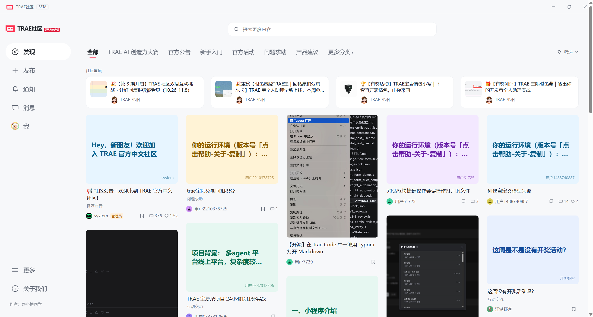
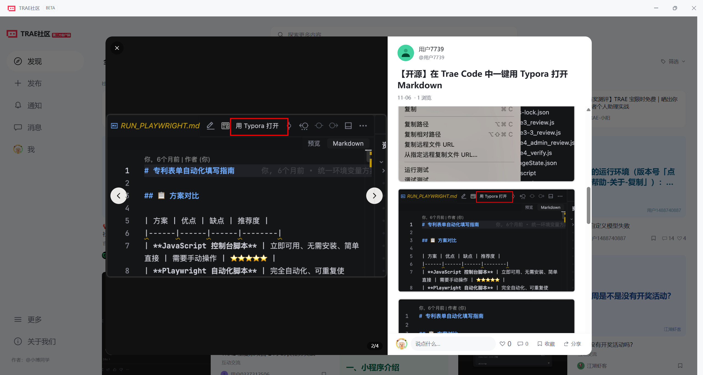
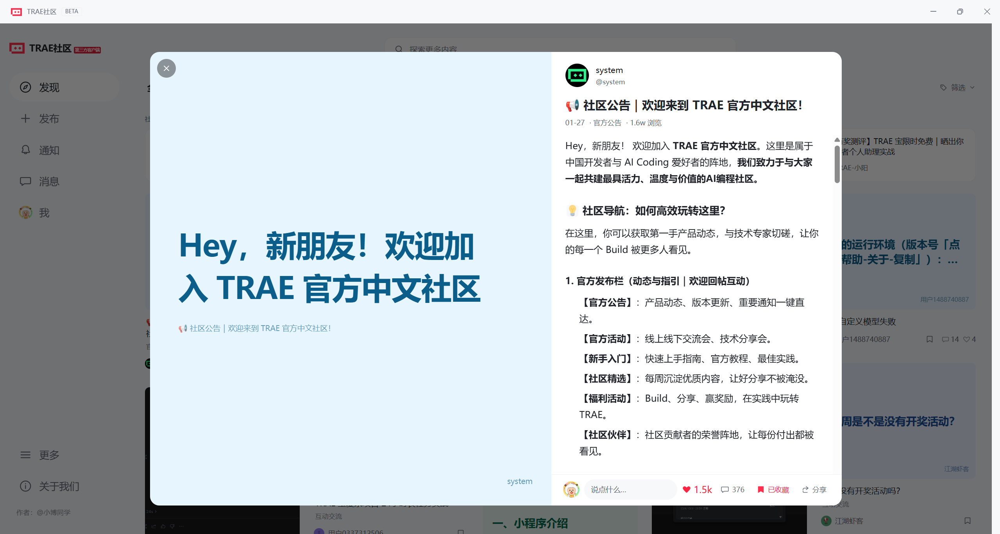
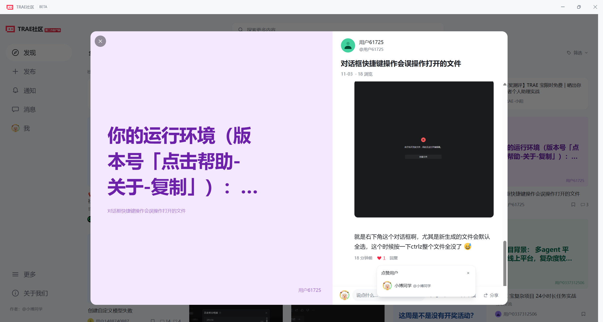

<div align="center">


# TRAE社区

**TRAE Forum Client · 社区第三方桌面客户端**

用瀑布流发现新话题，在桌面上阅读、交流与分享。

[](https://github.com/Zibor233/TRAE-Forum-Client/releases/tag/v0.1.2Beta)
[](#下载安装)
[](LICENSE)

[**下载安装**](https://github.com/Zibor233/TRAE-Forum-Client/releases/tag/v0.1.2Beta) · [更新日志](RELEASE_NOTES.md) · [问题反馈](https://github.com/Zibor233/TRAE-Forum-Client/issues) · [作者分享帖](https://forum.trae.cn/t/topic/465310/)



</div>

> 社区用户开发的开源项目，与 TRAE 官方无隶属关系。论坛内容、账号权限及操作结果以官方服务为准。

## 把社区放到桌面上

| 发现与阅读 | 交流与创作 | 账号与桌面 |
| --- | --- | --- |
| 自适应瀑布流与分类、标签筛选 | 评论下滑加载、楼层与回复对象 | Windows、macOS、Linux 五个平台构建 |
| 最新话题、新帖与更新提示 | 发帖与评论输入 `@` 搜索用户 | 官方 User API Key 授权，密钥保存在本机 |
| 分栏详情、清晰大图与图片切换 | 全屏编辑、实时预览与草稿 | 收藏同步论坛，个人资料可编辑 |
| 搜索话题、关闭详情后继续浏览 | 频道聊天、帖子式私信、用户卡片 | 通知一键已读、深浅主题、更新检测 |

## 界面一览

### 阅读与图片，放在同一个窗口

左侧浏览大图，右侧阅读正文与评论；点击正文图片可切换对应大图，底部可以点赞、收藏、回复和复制原帖链接。



<table>
  <tr>
    <td width="50%" valign="top">
      <strong>收藏，随时回来继续看</strong><br /><br />
      <a href="doc/images/bookmarks.png"></a>
      <p>首页卡片和帖子详情均支持收藏、取消收藏，同步论坛账号。</p>
    </td>
    <td width="50%" valign="top">
      <strong>通知，集中处理</strong><br /><br />
      <a href="doc/images/notifications.png"></a>
      <p>查看评论与 @、赞和收藏等通知，一键同步已读状态。</p>
    </td>
  </tr>
  <tr>
    <td width="50%" valign="top">
      <strong>看看谁为内容点了赞</strong><br /><br />
      <a href="doc/images/likes.png"></a>
      <p>悬停查看点赞用户，点击头像或名称打开软件内的用户卡片。</p>
    </td>
    <td width="50%" valign="top">
      <strong>0.1.2Beta，继续打磨体验</strong><br /><br />
      <p>新增 @ 用户搜索和阅读时长上报，优化收藏卡片、个人主页及资料编辑。</p>
      <p>修复更新检测失败，支持系统代理与备用检测方式。发现新版本时提示前往 Releases 下载。</p>
      <a href="RELEASE_NOTES.md">查看完整更新日志 →</a>
    </td>
  </tr>
</table>

<sub>演示截图来自作者的 <a href="https://forum.trae.cn/t/topic/465310/">0.1.1Beta 分享帖</a>，点击图集图片可查看原图。0.1.2Beta 进一步调整了收藏卡片、个人主页和资料编辑弹窗，实际界面以当前版本为准。</sub>

## 下载安装

**[前往 0.1.2Beta 下载页面 →](https://github.com/Zibor233/TRAE-Forum-Client/releases/tag/v0.1.2Beta)**

| 你的设备 | 选择文件 | 说明 |
| --- | --- | --- |
| Windows x64 | `win-x64.exe` / `win-x64-portable.exe` | 安装版 / 便携版 |
| Mac · Intel 芯片 | `mac-x64.dmg` / `.zip` | Intel 架构 |
| Mac · Apple Silicon | `mac-arm64.dmg` / `.zip` | M 系列芯片 |
| Linux x64 | `linux-amd64.deb` / `linux-x86_64.AppImage` / `linux-x64.tar.gz` | 根据发行版选择格式 |
| Linux ARM64 | `linux-arm64.deb` / `.AppImage` / `.tar.gz` | 包含麒麟 V10 ARM64 的适配处理 |

文件名带有 `TRAE-Forum-Client-0.1.2-beta.1-` 前缀；`SHA256SUMS.txt` 可用于校验下载文件。

- Windows 安装包未签名；macOS 安装包未签名及公证，系统可能提示需要确认来源。
- 麒麟 V10 ARM64 为重点适配目标，不同 SP、桌面环境与驱动组合仍需真机验证。
- 软件内“检测更新”会提示新版本并打开下载页，目前不会自动下载安装。

## 0.1.2Beta 更新

- **更新检测更稳**：支持系统代理，GitHub API 不可用时使用备用检测方式。
- **点赞状态更准确**：按论坛权限判断是否可以取消点赞，详情点赞数量仅统计首帖。
- **支持 @ 用户**：发帖、评论可搜索和选择用户，正文提及可打开用户卡片。
- **累计阅读时长**：按实际可见楼层计时，后台、编辑回复或长时间无操作时暂停。
- **个人主页更一致**：修复标签切换时侧栏跳动，收藏采用与笔记一致的封面卡片。
- **资料编辑更顺畅**：表单可上下滚动，标题与保存按钮固定可见，适配较小窗口。

详细内容见 [更新日志](RELEASE_NOTES.md)。

## 首次登录

1. 打开客户端，点击侧栏的“登录”。
2. 在登录面板中打开论坛授权页，使用自己的论坛账号确认授权。
3. 复制授权页显示的 payload，回到客户端粘贴并完成登录。

客户端采用 Discourse 官方 **User API Key** 授权流程。目前使用手动复制授权结果的方式完成登录，不需要在客户端填写论坛密码。可在论坛的应用授权管理中撤销访问权限。

**请求从你的电脑发出。** 桌面版通过本机服务连接官方论坛接口，无需共用项目作者的服务器转发。密钥存储在本机，不提交到项目仓库；提交 Issue 时请勿附带密钥或授权 payload。

## 本地开发

环境：**Node.js 24**、npm。

```bash
npm ci
npm run dev
```

浏览器打开 `http://localhost:5173`。开发命令会同时启动 Vite 和 `127.0.0.1:8787` 的本地 API 代理。

```bash
# 验证
npm test
npx tsc --noEmit
npm run build

# 启动桌面应用
npm run desktop

# 按目标平台打包（建议在对应系统或 GitHub Actions 上运行）
npm run desktop:win
npm run desktop:mac
npm run desktop:linux
```

浏览器构建预览需要本地代理同时运行：先执行 `npm run build`，再分别运行 `npm run proxy` 与 `npm run preview`。普通网页直接跨域访问论坛接口受站点 CORS 配置限制，纯静态部署不能替代本地代理。

技术栈：**React · TypeScript · Vite · Tailwind CSS · Electron**。桌面构建通过 GitHub Actions 覆盖五个平台，安装包发布在 Releases。

<details>
<summary><strong>项目结构</strong></summary>

```text
src/
  components/       帖子详情、编辑器、用户卡片及通用组件
  pages/            信息流、搜索、通知、消息与个人主页
  lib/              授权、缓存、请求队列、阅读计时等
  api.ts            论坛接口调用
desktop/            Electron 窗口、安全边界与更新检测
proxy/              本地 API 转发、缓存与限流
build/              应用图标及平台打包资源
scripts/            开发、校验与桌面启动检查
tests/              自动化测试
doc/images/         README 演示截图
.github/workflows/  多平台构建与发布
```

桌面构建与兼容性细节见 [桌面打包说明](doc/05-桌面打包.md)。

</details>

## 反馈与参与

欢迎通过 [Issues](https://github.com/Zibor233/TRAE-Forum-Client/issues) 反馈问题或提出建议，也欢迎提交 Pull Request。

反馈时请说明软件版本、系统版本、芯片架构、复现步骤，并尽量提供截图。麒麟用户可附上具体 SP 与桌面环境，便于定位兼容问题。

---

<div align="center">

由 [@小博同学](https://forum.trae.cn/u/%E5%B0%8F%E5%8D%9A%E5%90%8C%E5%AD%A6) 开发 · [MIT 开源协议](LICENSE)

如果这个客户端对你有帮助，欢迎点一个 Star，也欢迎把使用体验分享给社区。

</div>
